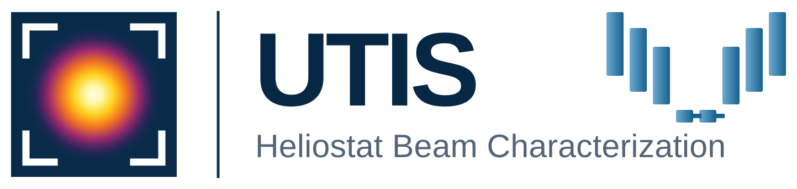
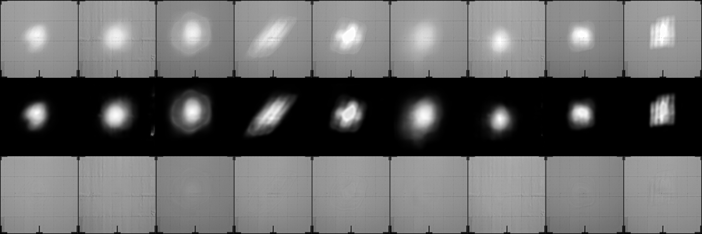

<p align="center">

</p>

[](https://doi.org/10.1016/j.solener.2024.112811)
[](https://opensource.org/licenses/MIT)
[](https://fair-software.eu)
[](https://www.python.org/downloads/)
[](https://github.com/astral-sh/ruff)
[](https://github.com/DLR-SF/UTIS-HeliostatBeamCharacterization/actions/workflows/tests.yml)

# UTIS – Heliostat Beam Characterization

**U**Net-based **T**arget **I**mage **S**egmentation for the camera-target method in solar tower power plants.

UTIS derives the irradiance profile of a single heliostat from one camera image of its focal spot on a
Lambertian calibration target. A UNet 3+ splits the image `I` into the relative flux density `X_r` and the
background `B`, accounting for background irradiation and the spatial reflectivity of the target. The relative
flux is then scaled to an absolute flux density `X` in W/m² using the total power of the focal spot, computed from
DNI, mirror area, mirror reflectivity and the angle of incidence. No flux gauges or moving bars are needed.

The network is trained exclusively on synthetic images: raytraced focal spots, multiplied by the target
reflectivity, superposed on real images of the empty target (`I = R · X_r + B`).

For details see the paper:
> M. Kuhl, M. Pargmann, M. Cherti, J. Jitsev, D. Maldonado Quinto, R. Pitz-Paal,
> *In-situ UNet-based heliostat beam characterization method for precise flux calculation using the camera-target
> method*, Solar Energy 279 (2024) 112811. [doi:10.1016/j.solener.2024.112811](https://doi.org/10.1016/j.solener.2024.112811)

<div align="center">
  
  <p><em>Real target images (top), predicted relative flux (middle) and predicted background (bottom).</em></p>
</div>

## Trained models

| File | Training data | Notes |
|---|---|---|
| [`trained_models/UNet3plus.ckpt`](trained_models/UNet3plus.ckpt) | Solar Tower Jülich, lower target | Model of the paper (Lightning checkpoint) |
| [`trained_models/utis_model_scripted.pt`](trained_models/utis_model_scripted.pt) | Solar Tower Jülich upper and lower target, Multi Focus Tower | TorchScript, used by [PAINT](https://github.com/ARTIST-Association/PAINT). The path is referenced externally and stays stable. |

The TorchScript model can be used without installing UTIS:

```python
import torch
model = torch.jit.load("utis_model_scripted.pt").eval()
prediction = model(images)          # images: B x 1 x 256 x 256 in [0, 1]
relative_flux, background = prediction[:, :1], prediction[:, 1:]
```

## Installation

```sh
git clone https://github.com/DLR-SF/UTIS-HeliostatBeamCharacterization.git
cd UTIS-HeliostatBeamCharacterization
pip install -e ".[plot]"        # add ",dev" for tests and linting, ",onnx" for ONNX export
```

## Input images

UTIS expects rectified, cropped target images of **256 × 256 pixels** in grayscale (8 or 16 bit), covering the
target region between the four crop markers. Raw camera images can be cropped and rectified with the marker-based
preprocessing of PAINT:
[`crop_image_and_detect_aimpoint.py`](https://github.com/ARTIST-Association/PAINT/blob/main/preprocessing-scripts/crop_image_and_detect_aimpoint.py).
That script outputs the green channel of the camera image, which can be passed to the model directly. RGB images
loaded with `utis.data.load_image` are converted with the linear weighting `(R + 2G + B) / 4` described in the paper.

The absolute scaling assumes that the whole focal spot is on the target (no spillage) and that there is no shading
or blocking.

## Usage

### Python API

```python
from utis import STJ_LOWER, FluxPredictor, absolute_flux, get_target
from utis.flux import STJ_HELIOSTAT_AREA

predictor = FluxPredictor.from_file("trained_models/UNet3plus.ckpt")   # or the TorchScript model
prediction = predictor.predict_folder("data/real_samples/solar_tower_juelich_lower")

flux = absolute_flux(                       # W/m², B x 1 x 256 x 256
    prediction.relative_flux,
    dni=dni,                                # W/m² per image
    sun_direction=sun,                      # heliostat -> sun, (B, 3)
    aim_direction=aim,                      # heliostat -> focal spot centre, (B, 3)
    mirror_area=STJ_HELIOSTAT_AREA,
    mirror_reflectivity=0.87,
    target_area=get_target(STJ_LOWER).area,
)
```

A complete example including a figure like Fig. 4 of the paper is in
[`examples/absolute_flux.py`](examples/absolute_flux.py).

### Command line

```sh
# relative flux and background for a folder of images -> result grid (and optionally tensors)
utis predict trained_models/UNet3plus.ckpt data/real_samples/solar_tower_juelich_lower --output results.png

# train (see configs/) and follow the progress in TensorBoard
utis train --config configs/paper.yaml
utis train --config configs/multi_target.yaml --set trainer.max_epochs=200 data.batch_size=16
tensorboard --logdir runs

# export a checkpoint
utis export runs/multi_target/version_0/checkpoints/last.ckpt model_scripted.pt --format torchscript
utis export trained_models/UNet3plus.ckpt model.onnx --format onnx
```

## Training

Training data are generated on the fly from the images in [`data/`](data/README.md):

```
data/
├── empty_targets/<target>/   images of the empty target (backgrounds B)
├── fluxes/<flux set>/        raytraced focal spots X_r (16-bit PNG)
└── real_samples/<target>/    real images, shown in TensorBoard during training
```

Target names follow the PAINT database (`solar_tower_juelich_upper`, `solar_tower_juelich_lower`,
`multi_focus_tower`), see [`src/utis/targets.py`](src/utis/targets.py). Each target uses the flux set matching its
physical size: both Solar Tower Jülich targets share `fluxes/solar_tower_juelich`, the Multi Focus Tower uses
`fluxes/multi_focus_tower`.

| Config | Targets | Corresponds to |
|---|---|---|
| [`configs/paper.yaml`](configs/paper.yaml) | STJ lower | `UNet3plus.ckpt` |
| [`configs/multi_target.yaml`](configs/multi_target.yaml) | STJ upper, STJ lower, MFT (incl. 5 % empty-target samples) | `utis_model_scripted.pt` |

Backgrounds and fluxes are split into training and validation images (`data.val_fraction`, default 10 %). Validation
samples are generated reproducibly without augmentation; the best checkpoint is selected by the relative flux
deviation of Eq. (14) (`val_flux_deviation`). Runs, configs and checkpoints are written to `runs/<name>/version_<n>/`.
Use `init_from=<checkpoint>` to fine-tune an existing model and `resume_from=<checkpoint>` to continue a run.

## Repository structure

```
├── configs/            training configurations
├── data/               empty-target images, simulated fluxes and real samples
├── docs/images/        figures and logos
├── examples/           usage examples
├── src/utis/
│   ├── model/          UNet 3+ and conversion of original checkpoints
│   ├── data/           image I/O, synthetic dataset, Lightning data module
│   ├── simulation.py   image synthesis (Eqs. 1, 5) and sample generation
│   ├── augmentation.py random transformations
│   ├── flux.py         absolute flux scaling (Eqs. 9-13)
│   ├── inference.py    model loading and prediction
│   ├── lightning_module.py, training.py, callbacks.py, metrics.py, optim.py
│   ├── export.py       TorchScript / ONNX export
│   ├── visualization.py
│   └── cli.py          `utis` command
├── tests/
└── trained_models/
```

## Development

```sh
pip install -e ".[dev]"
pre-commit install          # runs ruff (lint + format) before every commit
pytest
```

Code style follows PEP 8 and is enforced with [ruff](https://github.com/astral-sh/ruff) (configuration in
`pyproject.toml`); docstrings use the Google style.

## Citation

```bibtex
@article{kuhl2024utis,
  title   = {In-situ UNet-based heliostat beam characterization method for precise flux calculation using the camera-target method},
  author  = {Kuhl, Mathias and Pargmann, Max and Cherti, Mehdi and Jitsev, Jenia and Maldonado Quinto, Daniel and Pitz-Paal, Robert},
  journal = {Solar Energy},
  volume  = {279},
  pages   = {112811},
  year    = {2024},
  doi     = {10.1016/j.solener.2024.112811}
}
```

UTIS is used in the [PAINT database](https://paint-database.org/) for operational CSP plant data:
K. Phipps, M. Kuhl, M. Weiel et al., *The PAINT database for operational concentrating solar power plant data
following FAIR data principles*, Nature Energy (2026). [doi:10.1038/s41560-026-02070-1](https://doi.org/10.1038/s41560-026-02070-1)

## License

The code is licensed under the [MIT license](LICENSE). The data in [`data/`](data/README.md) are licensed under the
[Community Data License Agreement – Permissive – Version 2.0](https://cdla.dev/permissive-2-0/), the same license
as the PAINT database.

## Acknowledgments

This work was funded by the Helmholtz Association (HGF) within the GANCSTR project (grant ZT-I-PF-5-069) and is
supported by the [Helmholtz AI](https://www.helmholtz.ai/) platform.

-----------
<div align="center">
  <a href="https://www.dlr.de/EN/Home/home_node.html"></a>
  <a href="https://www.fz-juelich.de/portal/EN/Home/home_node.html"></a>
  <a href="https://www.helmholtz.ai/"></a>
</div>
